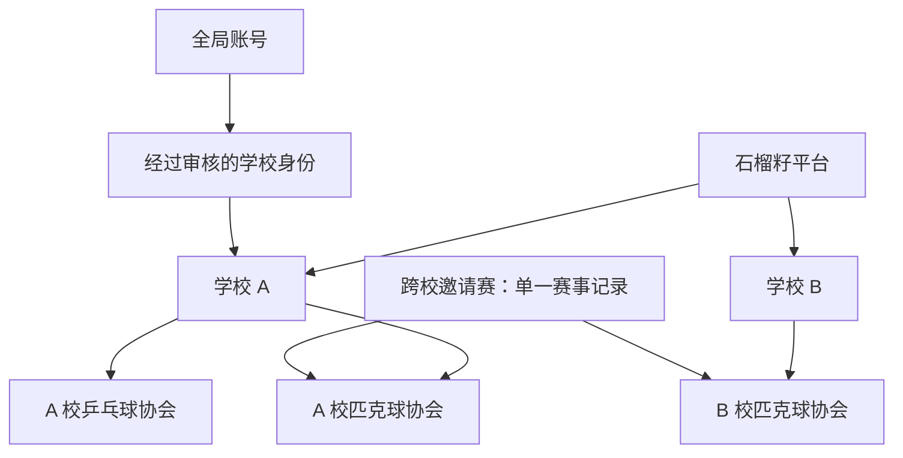

# 学校维度与跨校交流：需求及实施计划

日期：2026-10-13
状态：用户已同意按建议实施；第二所模拟学校为北京航空航天大学。S0/S1 基础代码进展见[实施记录](学校维度-S0-S1实施记录.md)，其余阶段尚未完成。
代码基线：`b94b5e2`（七项缺陷修复）。

## 1. 建议与本次目标

建议把产品从“中央民族大学的多个体育协会”扩展为“多个学校各自运营体育协会，共同举办交流活动”。**先完成学校隔离和本校运营，再以邀请赛打通跨校交流。**

学校应成为数据归属、身份审核和管理权限的一级范围。用户可以浏览外校公开内容，但切换到外校页面不会获得外校会员身份或管理权限。

第一阶段保留当前校内比赛、赛事、学院赛及计分规则，只增加学校维度。跨校交流第一版推荐做“指定学校参加的单打邀请赛”，保存赛程、比分、名次与个人交流战绩，暂不影响各校原有等级分和赛季积分。后续再单独设计跨校积分体系。

本文件的默认建议均可调整。尚未确定的产品选择集中在第 12 节，不阻碍先评审数据模型和实施顺序。

## 2. 从现有实现看，哪些地方必须调整

| 当前实现 | 增加学校后需要的变化 |
| --- | --- |
| `utils/associations.js` 用 `pkb / tt / bd` 同时表示项目与协会，名称写有中央民族大学 | 保留这些运动项目代码，另外定义“某学校开设的协会”；同项目的两个学校是两个独立组织 |
| OpenID 对应全局账号，注册后隐式属于全部协会 | 全局账号继续唯一；学校身份需单独审核，只自动获得本校已启用协会的普通参与资格 |
| `users` 上有学院、学号、审核状态 | 学号、学院和在校状态归学校身份；平台停用与学校停用分开 |
| `memberships` 只按用户与协会记录负责人角色 | 角色键必须包含学校；新增校级管理员；当前全局管理员需逐个明确未来权限 |
| 内容主要靠 `association` 过滤；部分仓储先全表读取再过滤 | 校内内容按 `schoolId + association` 查询与校验；数据库查询本身也要带范围 |
| `seasons / rankings` 以及客户端台账按协会分桶 | 全部加入学校维度，避免两校共用缓存、赛季或报名自然键 |
| 学院名单全平台固定一份，学院名称参与判权和自然键 | 每校独立学院目录，改用稳定 `collegeId`，名称只用于展示 |
| 手工改分存在 `users.currentEloByAssoc`，初始分也按协会保存 | 分数配置和改分历史需按学校、项目、等级分池定位 |
| 首页、公告和个人统计跨协会汇总 | 默认只汇总当前学校的协会；跨校交流使用独立栏目与明确的赛事授权 |

已有的“绑定协会客户端”应扩展为绑定学校与协会的客户端。不要重新引入“临时修改全局学校、等待异步请求、再恢复”的方式。

本文是对原多协会方案的扩展：账号仍全局唯一，但“注册一次属于所有协会”收窄为“学校身份通过后，可参与本校启用的协会”。原方案中“全局管理员管理所有内容”的规则不能直接推广给每一位新学校管理员。

## 3. 产品范围与用户流程

### 3.1 第一阶段：学校内独立运营

首批保留中央民族大学，并配置至少一所测试学校；测试学校只使用虚构数据。学校新增与停用由平台维护，首版不开放任何人自行创建学校。

必须支持：

1. 展示学校名称、简称与学校主页；按学校列出已启用的协会。
2. 注册时选择学校，再选择该校学院并填写该校身份信息，由本校管理员审核。
3. 每校独立管理会员、协会负责人、学院负责人、公告、赛事、赛季和榜单。
4. 学校选择与协会选择清晰可见；浏览学校和本人所属学校分别显示。
5. 现有中央民族大学的历史数据全部保留，迁移前后比分、排名与赛季积分一致。
6. 支持停用学校、学校身份离校与学校身份停用，保留历史成绩及审计记录。

暂不包括：学校自助入驻审批系统、教育系统认证接入、多重在读身份、自由跨校约球、全国统一排行榜、跨校团体联赛、聊天、收费和支付。

### 3.2 学校与协会切换

- 已审核用户首次进入以本人当前所属学校为默认学校；未审核用户进入学校选择与申请流程。
- 学校内部延续现有协会默认选择规则；已无可用协会时展示明确空态，不自动跳到另一所学校。
- 切换学校用于浏览，不能修改身份归属。页面持续展示“正在浏览：某学校 / 某协会”。
- 学校内首页、公告汇总和榜单只显示当前学校的数据。“我的”中账号资料全局共享，学校身份、校内成绩和跨校交流战绩分别展示。
- 首版建议每次冷启动回到本人学校；不持久记忆外校浏览选择，减少误操作。
- 分享赛事或比赛链接携带稳定记录 ID 和学校范围。服务端以记录归属为准，不信任链接参数；页面在目标学校打开，但不自动改变用户的学校身份。
- 快速切换学校或协会时，旧请求可以完成，但不得覆盖新页面的数据。提交表单固定绑定打开时的学校和协会，提交前显示所属范围。

### 3.3 身份与审核

首版每个用户最多有一个有效的主要学校身份，可保留多个历史学校身份。外校邀请赛通过赛事参赛资格进入，不要求用户先成为主办学校会员。

学校身份状态：待审核、有效、已驳回、已离校、已停用。账号平台状态单独表示正常或平台停用。

- 修改昵称、头像不影响学校身份；修改学校、学号、学院属于身份变更，不能通过普通资料编辑直接生效。
- 转校先申请，由目标校审核，批准时原校身份转为离校，相关管理授权同步失效；历史学校和历史代表队不改写。
- 转校前若有进行中的参赛资格，首版由管理员处理退赛或等待赛事结束后再批准，避免一人临时代表两校。
- 毕业保留成绩；首版校友可查看历史，不默认允许继续报名。后续校友赛事单独设资格规则。
- 同一校内学号不可被两个有效身份占用，不同学校可有相同学号。并发审核也必须遵守这一约束。

## 4. 组织模型、角色与可见范围

### 4.1 模型建议



项目代码描述运动规则；学校协会描述运营组织。第一版约定每校每个项目最多一个协会，内容仍可使用现有 `association: 'pkb'` 字段，但其含义明确为项目代码，必须与 `schoolId` 共同定位校内协会。将来若允许一校同项目多个俱乐部，再引入独立组织 ID，不能直接复用这对组合。

学校信息、学校启用的协会、学院目录建议存数据库，运动规则模板继续放共享代码。这样新增学校通常是配置操作，特殊比赛规则的变化仍经过代码评审与测试。首版可用受控初始化脚本维护配置，无须先建设完整运营后台。

### 4.2 权限矩阵

| 身份 | 授权范围 | 可以做什么 | 不应自动获得的能力 |
| --- | --- | --- | --- |
| 平台管理员 | 平台，少量指定账号 | 学校开通/停用、任免校管理员、处理跨校争议；审计下执行必要管理 | 静默伪装成普通会员操作 |
| 学校管理员 | 某一学校 | 审核本校身份、维护本校学院、任免本校协会负责人、管理本校内容 | 管理外校身份、任命平台管理员 |
| 协会负责人 | 某校某项目 | 管理该协会赛事、公告、指定学院负责人、按规则改分 | 修改学校归属、管理其他项目或其他学校 |
| 学院负责人 | 某校某项目某学院 | 审核/维护本学院参赛名单、按已有规则录分 | 因外校学院同名而获得外校权限 |
| 普通会员 | 本校参与资格；特定跨校赛事资格 | 报名、参与比赛、按规则录分与确认 | 浏览外校就获得其会员操作权限 |
| 赛事工作人员/裁判 | 明确指定的赛事或比赛 | 执行被授予的赛事操作 | 成为主办学校或受邀学校管理员 |

原有 `ROLE.ADMIN` 数值不能独自决定跨校权限。建议显式判断“操作 + 资源归属 + 角色授权范围”。需要复用旧的校内权限函数时，只能在学校、协会归属校验完成后构造局部有效角色。

第一阶段校级学校身份由学校管理员审核；协会负责人继续管理本协会业务。旧代码中协会负责人借用管理员有效角色的地方，要逐接口检查是否误获校级审核权。

### 4.3 默认可见范围

公开学校目录、学校简介及主动发布的公开公告可以跨校浏览。建议首版校内会员名册、个人成绩详情和校内榜单只对本校有效会员及相应管理者开放；对外展示的赛事名单、比分和名次由赛事的可见策略决定。

跨校页面默认只提供昵称、学校、赛事所需的项目与成绩；学号、手机号、身份审核材料不进入公开响应。实名认证姓名仅向审核人员和有核验需要的赛事工作人员按需提供。应设计专用公开字段投影，不能先返回完整账号再由页面隐藏。

## 5. 数据与接口设计建议

以下为目标模型；新集合名与字段需在开发前冻结。数据库约束应同时由稳定主键、服务端校验和事务实现，不能只依赖页面校验。

### 5.1 身份与组织

| 集合/对象 | 建议字段与唯一性 | 说明 |
| --- | --- | --- |
| `schools` | `schoolId`、名称、简称、状态、品牌、配置版本 | ID 稳定，不用学校中文名作键；中央民族大学建议 `muc` |
| `schoolAssociations` | `schoolId + association`、启用状态、展示名称、品牌配置 | 关联共享运动规则模板，不复制出多份算法 |
| `colleges` | `schoolId + collegeId`、名称、状态 | 同名学院互不影响；停用保留历史引用 |
| `users` | 全局用户 ID、OpenID、昵称、头像、平台状态、平台角色 | 沿用原用户 ID；OpenID 唯一的前提是使用同一个小程序主体与 AppID，不默认跨 AppID 通用 |
| `schoolMembers` | `userId + schoolId`、`collegeId`、学号、身份状态、审核记录、加入/离校时间 | 校内业务资格的来源；姓名与联系方式的读取需按用途授权 |
| `schoolRoles` | `userId + schoolId`、校级角色、状态、授予人 | 只表示校级管理授权，不把学校管理员写成全局 ADMIN |
| `memberships` | `userId + schoolId + association`、协会角色、`collegeId`、状态 | 保留目前按需存高权限角色的方式；普通参与资格来自 schoolMembers |
| `memberRatings` | `userId + schoolId + association`、初始分、各池改分事件列表 | 移出全局 users 上按协会分数的隐含单校结构；最终分仍由比赛回放得到 |

主要学校归属与“只能有一个有效学校身份”需要一个可事务读写的用户级指针，例如 `users.primarySchoolId`。审批时同时校验并更新指针与学校身份，避免两个学校同时通过申请。这个指针只用于定位和一致性约束，不能替代学校身份的状态校验。

同校学号占用可使用 `schoolId + 规范化学号` 的唯一占用文档，在审批事务中登记。原始学号作为受限资料保存，不出现在公开文档 ID 或日志里。转校、离校后的学号释放规则需保留审计，首版不允许自行重新绑定其他账号。

### 5.2 内容、缓存与主键

校内内容包括 `matches / events / eventSignups / announcements / collegeEvents / collegeEntries / ties / lineups / liveScores`，统一带 `schoolId` 和 `association`。子记录还需校验父赛事、父比赛的归属，禁止只对当前子记录盖章。

赛季和排行榜定位从“协会”改为“学校 + 项目”。缓存键还包含数据版本、算法版本及身份/学校配置版本；个人分数再按现有等级分池拆分。

必须一起核对：

- 新比赛、赛事、公告的自然键加入学校范围；旧主键迁移时原则上保留，不因学校补字段就批量重建比赛 ID。
- `memberships` 等由范围生成的角色键需建立旧键到新键映射后迁移。
- 报名键 `eventId + userId`、实时比分键 `matchId` 在父 ID 全局唯一且不变时可以保留，但每次读写仍校验父级学校归属。
- 学院赛名单、排阵改用学校内的学院 ID，不能再仅用学院显示名称识别。
- 学校级身份/授权变更使该校受影响的项目缓存失效；昵称等全局资料变更应覆盖该用户出现的校内与交流视图，避免重新出现跨范围旧快照。
- 可将公开资料与计分快照分离，读取时补齐资料；若继续合并存储，必须定义并测试完整的版本失效规则。

### 5.3 请求与服务端处理

建议校内客户端使用绑定范围接口：

```js
const api = services.forScope({ schoolId: 'muc', association: 'pkb' });
await api.getEvents();
```

请求中的学校和协会只是目标范围。服务端根据微信身份读取真实账号、学校身份、学校角色与协会角色，再验证目标资源。写入的学校、项目、参赛学校信息由服务端确认，不能让前端自由指定。

读取他校记录 ID、伪造主办学校、提交不属于该赛事的比赛编号，都必须被拒绝。读取接口也需要权限审查，包括个人战绩、实时比分、报名名单和跨协会汇总；不能只改写接口。

仓储增加按范围读取与分页能力，避免 `derive.buildDataset` 继续读取所有学校的账号与比赛再过滤。榜单的回放需要完整的本范围有效历史；数据库分页是分批取全该范围，不能误把第一页当作完整赛季。

索引按实际查询设计，至少覆盖内容的 `schoolId + association + 状态/时间`、学校身份的 `schoolId + status`、用户的学校身份查询，以及赛事报名查询。索引、分页和事务行为需在真实云开发环境验证，不能仅以内存仓储测试代替。

## 6. 跨校交流第一版

### 6.1 推荐闭环

1. 主办方在本校某协会创建“跨校邀请赛”，填写受邀学校、项目、时间、地点、总名额和每校名额。
2. 受邀学校的校管理员或相应协会负责人确认参加。未接受邀请的学校不能报名；首版不开放未知学校自由加入。
3. 有效学校会员本人报名，服务端验证其所属学校已经接受邀请。主办方进行签到与赛程管理。
4. 按现有抽签、录分、对手确认和实时计分流程完成比赛。首版跨校种子采用人工指定或随机，不把不同学校的校内 ELO 混排为统一实力顺序。
5. 结束后生成单一正式成绩，双方可在交流战绩中查看；异议由赛事管理员处理，平台管理员负责跨校升级争议。

建议先完成单打邀请赛，再扩展双打、混校搭档和校际团体赛。后两者的队伍资格与名单审核规则需独立需求，不能直接把现有“学院”字段替换成“学校”。

### 6.2 赛事唯一归属与授权

跨校赛事只保存一份主记录。推荐在现有 `events` 增加：

```js
{
  schoolId: 'muc',              // 主办学校，也是归属学校
  association: 'pkb',
  eventScope: 'inter_school',
  participantSchoolIds: ['muc', 'school_b'],
  ratingPolicy: 'unrated',
  visibility: 'participants'
}
```

邀请、接受状态、每校名额与工作人员权限另存关联记录；上例名单仅表示赛事关联学校，不单独构成报名资格。赛事确认参加后再授予该校相应访问能力。

生成的比赛沿用主办学校范围，通过赛事授权让外校选手查看、录分或确认。服务端必须有按赛事获取“参赛者名单”的路径，不能再要求所有对手都出现在主办学校普通会员列表中，也不能因此把外校用户加入主办学校的全部会员列表。

报名保存 `representedSchoolId`、身份记录引用以及必要的学校/姓名展示快照。赛程锁定后不能因用户改名、转校而改变其当时代表的学校；身份失效或校方撤回参加时，由管理员按退赛/弃权流程处理。

总名额与每校名额都在同一事务内校验和更新；并发报名、取消、学校撤回、抽签冻结需遵守统一状态机。沿用本轮修复中的“共享赛事文档冲突与事务内复查”原则。

### 6.3 等级分与积分建议

**首版跨校比赛不进入校内 ELO 回放，不计校内赛季积分，不产生全国 ELO 榜。**当前各校样本、校准和对手网络尚未统一，同样的分值不一定代表相同水平。

校内回放要按服务端可信的 `ratingPolicy` 排除交流赛，不能只凭 `eventId` 判断计分；交流战绩与校内战绩分开汇总，避免“不计分但影响定级样本/场次”的间接计分。

下一阶段若决定建设跨校等级分，应定义独立计分范围，例如“某联盟 + 项目 + 等级分池”，从指定开始日期累计，明确初始定级、计分赛事、重赛/撤销和历史回放规则。校内分数可作为人工参考，不直接相加、平均或平移成跨校统一分数。

转校后原校历史与评分保留，新校从本校规则开始定级；若要承认转入成绩，采用有依据的入池初始分审批，不复制原校比赛流水。

## 7. 原有数据迁移

当前仓库配置仍以模拟数据为主，实际云环境部署和存量数据情况需实施时先核实。即使尚无线上数据，也应通过现有夹具和导入样本完成迁移演练。

迁移建议使用停写窗口，首版避免兼容双写：

1. **盘点与备份**：统计各集合数量、引用关系、缺失字段、异常学号及账号权限；输出可恢复备份和各协会回放基准。
2. **建立组织目录**：创建 `muc`、现有三个学校协会和学院 ID 映射；校对学院别名与无法匹配的记录，不能默默归入默认学院。
3. **账号拆分**：保留全部用户 ID/OpenID；创建本校身份，映射原待审核、离校、停用等状态。原普通账号保持平台正常，原学校禁用不自动扩大为平台禁用。
4. **权限迁移**：原学院/协会角色加学校范围；旧 ADMIN 名单人工确定哪些保留平台权限、哪些变成本校管理员，不能全部自动升为平台管理员。
5. **内容回填**：已确认属于当前单校系统的存量内容补 `schoolId: 'muc'`；同时迁移学院引用、初始分与完整改分时间线，保持比分、时间和业务主键不变。
6. **赛季与缓存**：迁移各协会赛季锚点、分界时间、赛季编号与版本至新范围；旧榜单快照废弃并重建，不将新学校的数据合并进旧快照。
7. **核对与切换**：逐协会比较会员资格、比赛数、所有选手等级分、排名、积分、赛事名次和引用完整性；安装索引、启用新服务与客户端后进行只读验收，再解除停写。

迁移脚本要求支持预演、不重复写入、分批执行、断点续跑、异常清单和完成标记。旧学校缺省兼容只用于已识别的存量迁移；上线后新请求缺少学校范围应拒绝，不永久静默归入中央民族大学。

客户端与服务端需有协议版本校验。多学校开放后，旧客户端缺少学校信息时要求升级，避免把它的操作错误归入默认学校。

回滚不能只切回旧代码：停写、恢复匹配版本的代码和迁移前备份、核对后再开放。若解除停写后已有新数据，先导出并制定补录/前向修复方案，禁止用旧备份直接覆盖新增的学校与成绩。

## 8. 代码改造清单

以下路径相对于仓库根目录；均为计划，不代表已修改。

| 层 | 主要落点 | 改造任务 |
| --- | --- | --- |
| 组织与规则 | `miniprogram/utils/associations.js`、`constants.js`，新增组织目录服务 | 分离项目模板与学校协会；定义学校、学院、身份状态 |
| 账号与权限 | `services/auth.js`、`member-review.js`、云端 `core/context.js`、`member-handlers.js` | 拆分学校身份；校级角色；按范围判权；转校与审核状态机 |
| 仓储 | `cloudfunctions/data/src/repository.js`、数据库与内存适配器 | 新集合、范围查询、分页、主键与索引、事务约束 |
| 云端入口与处理器 | `core/dispatch.js`、各比赛/赛事/学院赛/实时比分处理器 | 可信上下文、父子归属校验、公开字段投影、旧协议拒绝 |
| 回放与缓存 | `core/derive.js`、`season.js`、`idempotency.js`、相关评分服务 | 学校范围的样本、改分、赛季、缓存与自然键；交流赛计分排除 |
| 客户端 | `services/index.js`、`cloud.js`、`association-scope.js`、`mock.js` 和各 store | `forScope`；学校与项目双维台账；异步请求不串范围 |
| 视图与页面 | 首页、公告、登录/审核、榜单、资料、赛事及 `templates/member-view.js` | 学校选择、范围标识、审核归属、跨校只读/报名状态与空态 |
| 工具与文档 | `tools/`、`tests/`、云部署说明、交接文档 | 迁移与核对脚本、多校夹具、回归矩阵、部署与回滚步骤 |

涉及纯共享模块的修改继续通过 `tools/sync-cloud-lib.js` 同步，不手动编辑云端镜像。模拟数据至少覆盖两校同项目、同名学院、相同学号、同一账号不同历史学校，才能验证真正的隔离。

## 9. 分阶段实施与交付门槛

以下顺序以每阶段可单独验收为原则。工期应在需求冻结、云环境核实和迁移样本确认后估算，避免把权限改造当作简单加字段。

| 阶段 | 工作与交付物 | 完成门槛 |
| --- | --- | --- |
| S0 规则冻结 | 决策第 12 节；盘点接口和存量；产出字段字典、权限矩阵、迁移样本 | 每条内容归属、每种角色边界、每种历史状态都有明确映射 |
| S1 学校基础 | 学校/学院/学校协会目录、学校身份、角色模型、双范围仓储与测试夹具 | 两校同项目的数据、角色、主键、缓存互不串用；尚不开放外校用户 |
| S2 校内业务贯通 | 改造全部处理器、计分、门面、mock 与页面；注册审核、校内赛事与学院赛闭环 | 两校分别独立完成全流程；当前中央民族大学行为无回归 |
| S3 迁移与试点 | 迁移预演、索引、真实云联调、协议升级、备份/回滚演练 | 全量基准对账一致；学校 A 无法越权读写 B；先本校再小范围第二校试点 |
| S4 跨校邀请赛 | 邀请接受、每校名额、赛事授权、跨校参赛名单、交流战绩 | 两校单打一场赛事完整结束；仅一份正式成绩；校内评分不变 |
| S5 按需扩展 | 双打/校际团体、校友资格、自助学校管理、独立联盟评分 | 分别有独立需求与验收方案，不作为第一期上线前置条件 |

依赖顺序：S0 → S1 → S2 → S3 → S4。S4 的数据模型可在 S0 提前预留，但跨校资格与写操作在 S3 验证之前保持关闭。

## 10. 验收用例

| 场景 | 必须满足的结果 |
| --- | --- |
| A、B 两校都有匹克球协会和同名学院 | 名单、角色、榜单、赛事和学院赛互不混淆 |
| A 校负责人把请求中的 schoolId 改为 B 校 | 无法审核、改分、录入非授权比赛或读取 B 校受限资料 |
| 直接猜测外校会员/赛事/比赛/实时比分 ID | 仍执行资源权限校验；错误响应不泄露受限信息 |
| 用户切到 B 校浏览 | 主学校身份和写入资格不变化，界面明确展示范围 |
| 快速切换学校和项目，旧请求后返回 | 旧响应不覆盖新页面，提交固定绑定原表单范围 |
| 同时在两校审批一个人的转入申请 | 最多一个有效主要学校身份；旧管理授权不能继续使用 |
| 两个人并发提交/获批同校同学号 | 不生成两个有效占用；不同学校相同学号可正常存在 |
| 本校身份停用、学校停用或用户离校 | 阻止后续不允许的写操作，历史回放与公开赛事历史不崩溃 |
| 连续手工改分、冷启动重建快照 | 保留完整改分时间线，学校与项目分数均不串用 |
| 历史数据完成迁移 | 比分、成绩、等级分、积分、赛季锚点及业务引用与基准一致 |
| B 校用户报名 A 校邀请赛 | 受邀且通过本校审核时可报名；不能因此报名 A 校普通校内赛 |
| 最后一个总名额/学校名额被并发抢占 | 不超额；取消只释放一次；抽签后名单冻结 |
| 实时定稿中途数据库故障 | 正式比分与定稿状态一起回滚，可安全重试 |
| 跨校赛事重复提交、重试、撤销 | 一份正式记录，不在两校各复制一份、不重复计入交流战绩 |
| 完成跨校交流赛 | 显示交流名次；两校校内 ELO、定级样本与赛季积分保持不变 |
| 旧客户端向多校服务端发起缺范围请求 | 明确要求升级；不静默写入默认学校 |

单元测试之外，发布前必须用至少两校的真实云测试账号验证数据库事务、索引、分页、直接 ID 越权和分享链接。当前 2109 项测试作为回归基础，新增测试应验证多校行为而非只检查字段是否存在。

## 11. 主要风险与处理

- **权限扩大**：旧管理员数值在新模型中含义不清。采用显式学校授权，先完成角色映射与跨校拒绝测试，再接第二所学校。
- **历史计分变化**：学校过滤、学院 ID 与改分迁移可能改变回放输入。迁移前后逐人逐池对账，差异未解释清楚前不开放写入。
- **人员身份与参赛学校变化**：转校或离校不能改写旧赛程。使用经过审核的身份引用与赛事代表学校快照。
- **数据规模增长**：学校数增加后全表读取和全平台缓存失效会变慢。查询按范围下推，完整分页；用接近计划规模的夹具测量响应和云端调用开销，再设置上线性能门槛。
- **跨校扩展过早**：若同时引入全国分数、联赛、支付和聊天，学校基础很难单独验收。先以两校单打邀请赛检验组织、身份和权限模型。

## 12. 建议评审时确认的决定

| 决策 | 本文推荐默认值 | 若改变，影响什么 |
| --- | --- | --- |
| 学校接入方式 | 平台邀请并配置，先两校试点 | 自助入驻需要独立审核、配置后台和运营流程 |
| 一个人能否同时属于多校 | 一个有效主要学校，保留历史身份 | 多校有效身份需要参赛代表资格、报名冲突与角色优先级规则 |
| 会员是否还要逐协会审核 | 本校身份通过后，自动取得本校启用协会的普通参与资格 | 独立协会入会需新增协会会员状态，与负责人授权分开 |
| 外校能否看本校榜单和会员 | 首版不默认开放，公开交流赛另行展示 | 公开榜单需明确哪些姓名/成绩公开、退出展示的规则 |
| 跨校成绩是否计分 | 只计交流战绩，暂不改变校内分数与积分 | 统一评分需新规则、独立计分范围和校准方案 |
| 最早开放哪种交流 | 两校或少量学校的单打邀请赛 | 双打、混校搭档、团体赛分别补资格与组队规则 |
| 学校身份由谁审批 | 本校管理员；平台只处理必要争议 | 委托学院/协会审核需明确授权范围与防自审规则 |
| 校友是否可参赛 | 首版保留查看权限，不默认报名 | 校友赛事需区分学生组/公开组，并明确代表学校资格 |

按这些默认建议实施，可以先让每所学校独立使用现有完整功能，再用受控邀请赛连接学校。学校、项目、身份和计分范围各自有明确含义，后续扩展不会依赖不断增加“允许外校访问”的特殊分支。
